
<picture><source media="(max-width: 600px)" srcset="./assets/profile/hero-mobile.png">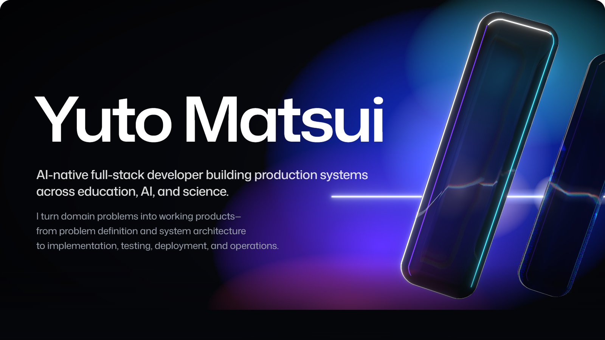</picture>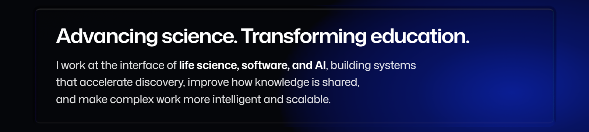<a href="https://dotnet.microsoft.com/">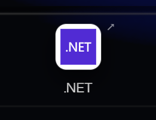</a>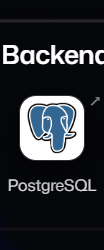<a href="https://www.postgresql.org/">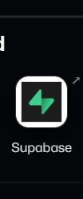</a>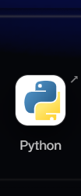<a href="https://huggingface.co/">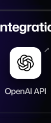</a>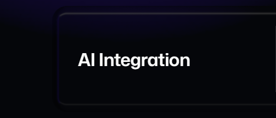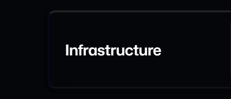<a href="https://nginx.org/">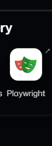</a><a href="https://developer.hashicorp.com/terraform">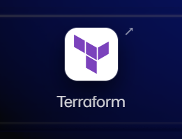</a><a href="https://github.com/features/actions">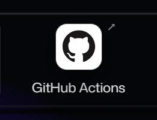</a>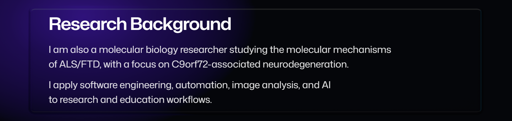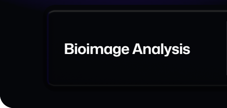<a href="https://fiji.sc/">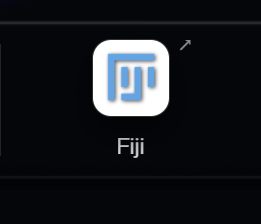</a><a href="https://www.cellpose.org/">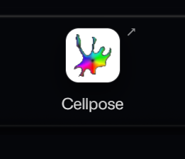</a><a href="https://github.com/stardist/stardist">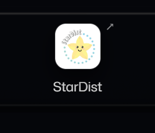</a>

