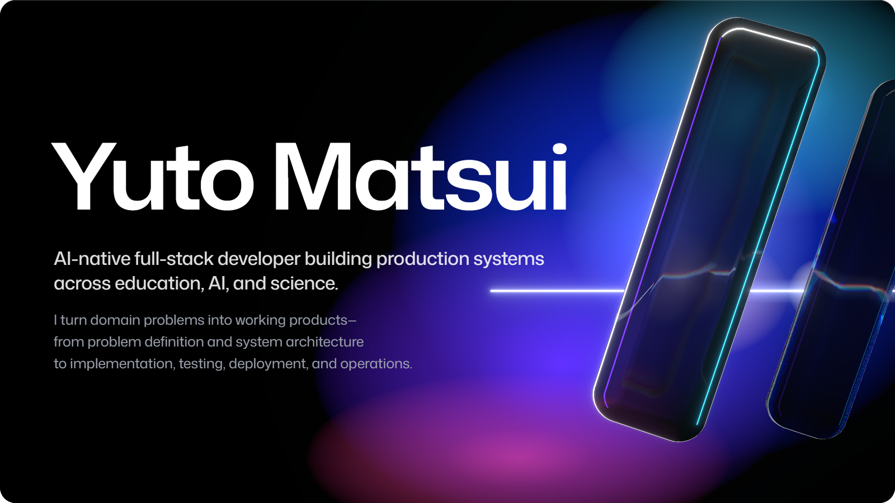
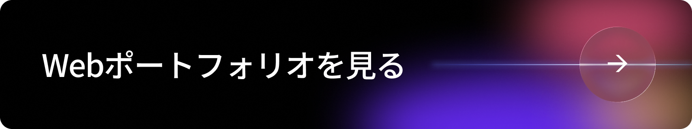
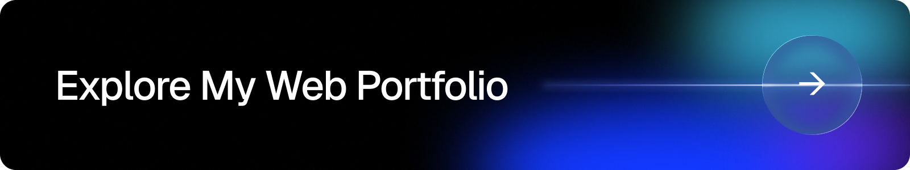
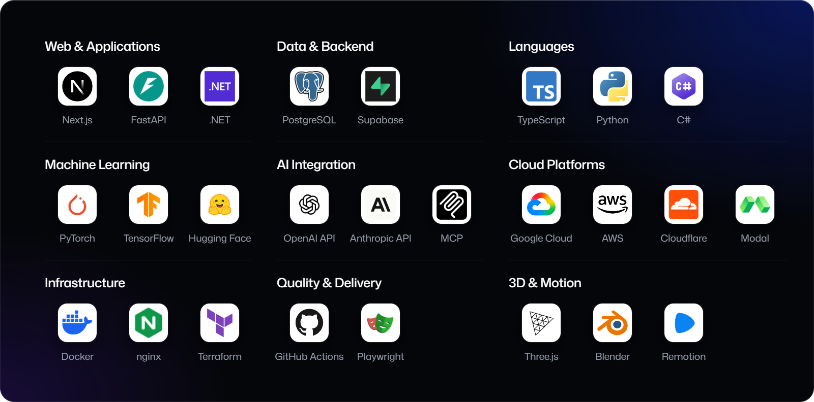
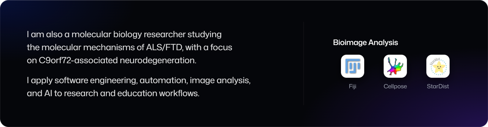

<picture>
  <source media="(max-width: 600px)" srcset="./assets/masthead-mobile.png">
  
</picture>

## Advancing science. Transforming education.

I work at the interface of **life science, software, and AI**, building systems that accelerate discovery, improve how knowledge is shared, and make complex work more intelligent and scalable.

### Technical Expertise

## Research Background

