<picture>
  <source media="(max-width: 600px)" srcset="./assets/yuto-matsui-masthead-mobile.svg">
  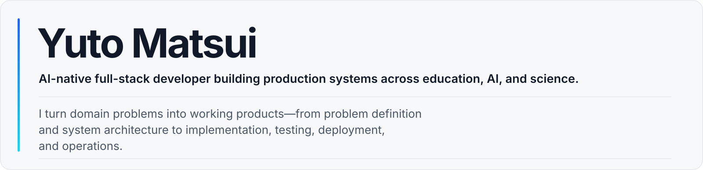
</picture>

&nbsp;

  <a href="https://yuto-matsui.com/">
    <picture>
      <source media="(max-width: 600px)" srcset="./assets/web-portfolio-wide-mobile.svg">
      
    </picture>
  </a>

## Advancing science. Transforming education.

I work at the interface of **life science, software, and AI**, building systems that accelerate discovery, improve how knowledge is shared, and make complex work more intelligent and scalable.

 

### Engineering Focus

- Scientific software and AI-native research systems
- Full-stack web and cloud engineering
- Data platforms and computational workflows
- Educational technology and interactive systems
- AI agents and agentic systems

 

### Technical Expertise

  <strong>Web &amp; Applications</strong> 
  <a href="https://nextjs.org/">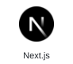</a>
  <a href="https://fastapi.tiangolo.com/">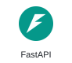</a>
  

  <strong>Data &amp; Backend</strong> 
  
  

  <strong>Languages</strong> 
  <a href="https://www.typescriptlang.org/">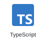</a>
  <a href="https://www.python.org/">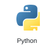</a>
  <a href="https://learn.microsoft.com/en-us/dotnet/csharp/">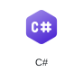</a>

  <strong>Cloud &amp; Infrastructure</strong> 
  
  
  <a href="https://www.docker.com/">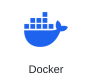</a>
  <a href="https://developer.hashicorp.com/terraform">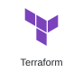</a>

  <strong>Quality &amp; Delivery</strong> 
  
  

  <strong>AI &amp; Machine Learning</strong> 
  <a href="https://pytorch.org/">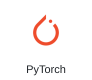</a>
  
  <a href="https://openai.com/api/">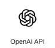</a>
  

  <strong>3D &amp; Motion</strong> 
  <a href="https://threejs.org/">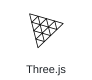</a>
  
  

 

## Research Background

I am also a molecular biology researcher studying the molecular mechanisms of ALS/FTD, with a focus on C9orf72-associated neurodegeneration.

I apply software engineering, automation, image analysis, and AI to research and education workflows.
