
<picture><source media="(max-width: 600px)" srcset="./assets/profile/hero-mobile.png"></picture><a href="https://yuto-matsui.com/en/">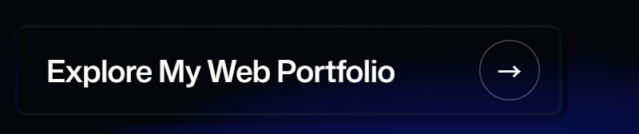</a><a href="https://nextjs.org/">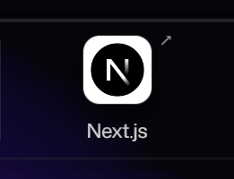</a><a href="https://fastapi.tiangolo.com/">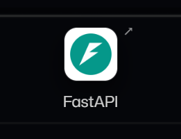</a>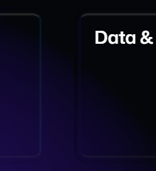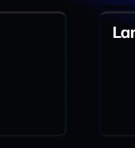<a href="https://learn.microsoft.com/en-us/dotnet/csharp/">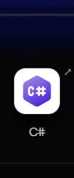</a><a href="https://pytorch.org/">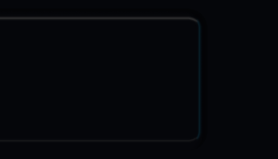</a><a href="https://www.tensorflow.org/">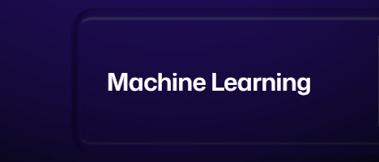</a><a href="https://huggingface.co/">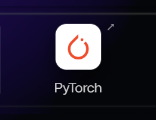</a>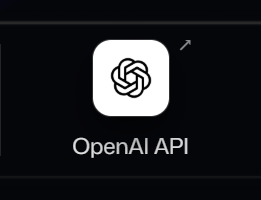<a href="https://cloud.google.com/">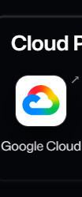</a><a href="https://aws.amazon.com/">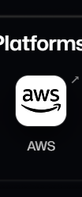</a><a href="https://modal.com/">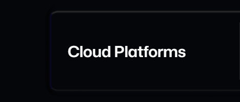</a>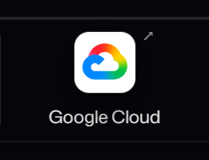<a href="https://nginx.org/">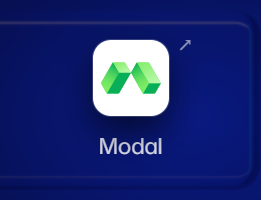</a><a href="https://github.com/features/actions">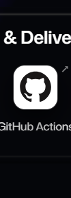</a><a href="https://threejs.org/">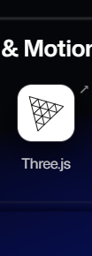</a>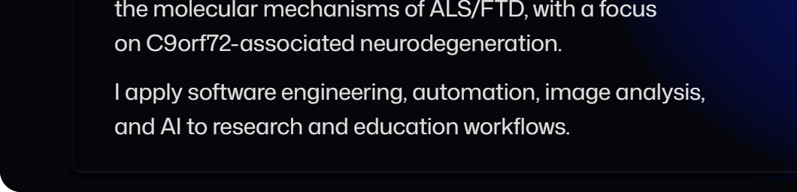<a href="https://www.cellpose.org/">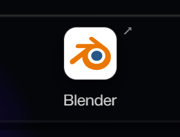</a>

